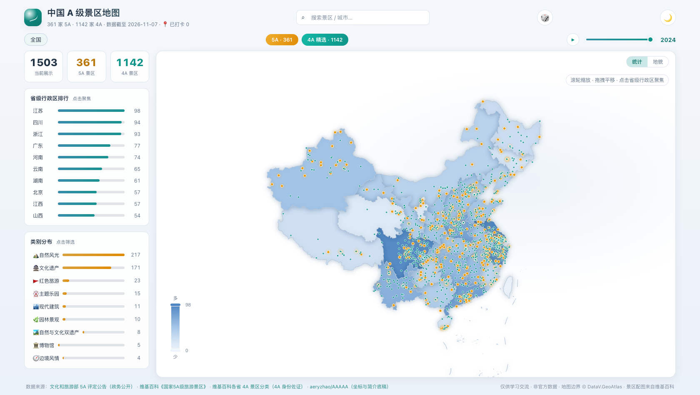
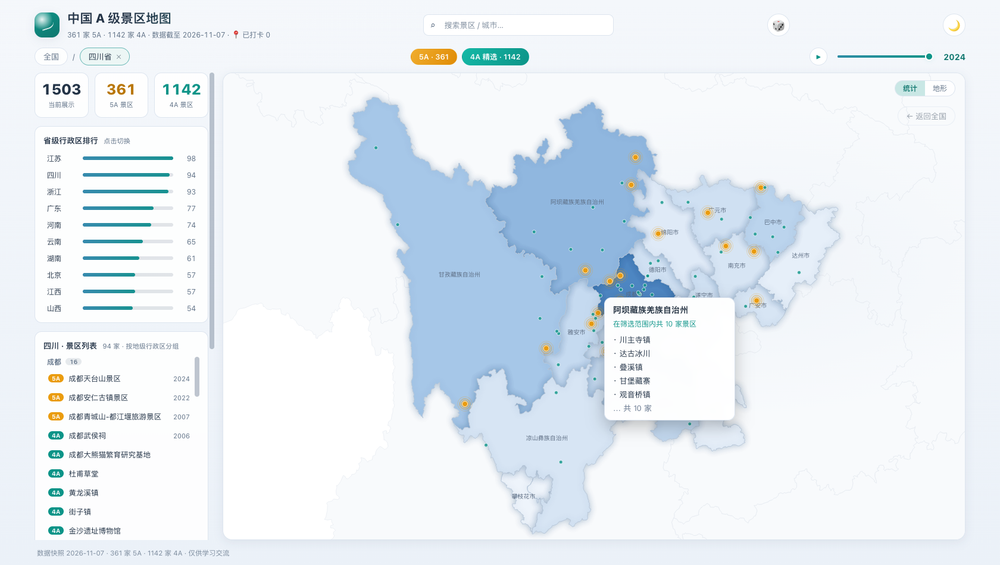
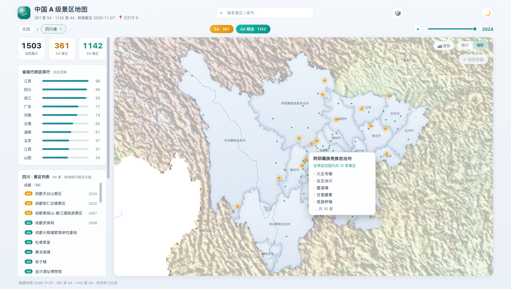

# 中国 A 级景区地图 · China Scenic Atlas

中国 A 级旅游景区交互式可视化：全国视图展示 5A/4A 分布，**点击省级行政区进入该省地图**（市级边界实体化、邻省淡化背景），支持等级/类别/年份筛选、年份演进动画、搜索与富详情。

**在线演示**：[alexanderj-carter.github.io/china-scenic-atlas](https://alexanderj-carter.github.io/china-scenic-atlas/)

 



## 特性

- **省图下钻**：点击省/直辖市/自治区/特别行政区 → 切换到该省地图（市级行政边界 + 市名标注 + 按市计数），邻省淡化背景可点击切换，`Esc` / 面包屑返回全国
- **统计 / 地形双模式底图**：统计模式按景区数量分级着色；地形模式为**真实 DEM 地形**
  （构建期从公开高程数据生成晕渲图 + 分层设色，与 Lambert 投影逐像素对齐）+ 河流
  （Natural Earth 11 条干流）+ 山脉/高原/盆地标注 + 省名半透明标注
- **浅色 / 深色主题**：跟随系统偏好、一键切换、图表配色联动
- **双等级标注**：5A 金色标记（悬停涟漪），4A 青色散点；choropleth 按区域计数着色
- **筛选**：等级开关、类别分布、评级年份滑块 + 年份演进播放
- **搜索**：名称/城市模糊搜索，键盘导航，直达省图 + 详情
- **详情**：代表配图与简介（本地库；5A 简介与开放时间全覆盖）、门票/官网（缺项诚实标注）、同省推荐卡片；数据口径收进 ⓘ 折叠
- **探索工具**：区域切换、足迹筛选、CSV 导出、随机探索、打卡（localStorage）
- **性能**：空闲画布零重绘（涟漪仅悬停触发）、渲染去抖、4A 全量按需加载（不进首屏包）

## 快速开始

```bash
npm install
npm run dev          # 开发
npm run build        # 类型检查 + 构建
npm run preview      # 预览构建（另开终端）
npm test             # 单元测试
npm run e2e          # 无头 Chrome 端到端冒烟测试（需 Chrome，CHROME_PATH 可指定路径）
```

要求 Node.js ≥ 22。地图边界、景区数据与维基简介/配图 URL 全部 vendor 进仓库，运行时零外部依赖（详情配图懒加载自 Wikimedia，离线自动降级为分类插画）。

## 数据

| 数据 | 条数                                                                             | 来源                                                                                                                                                                                            |
| ---- | -------------------------------------------------------------------------------- | ----------------------------------------------------------------------------------------------------------------------------------------------------------------------------------------------- |
| 5A   | 361（大陆官方 359 + 港澳参考 2）                                                 | [文旅部评定公告](https://zwgk.mct.gov.cn/zfxxgkml/zykf/) + [维基百科《国家5A级旅游景区》](https://zh.wikipedia.org/wiki/国家5A级旅游景区) + [aeryzhao/AAAAA](https://github.com/aeryzhao/AAAAA) |
| 4A   | 1142（维基各省分类 + Wikidata 坐标补全 + 103 条人工精选）                        | [维基百科各省 4A 分类](https://zh.wikipedia.org/wiki/Category:4A级旅游景区) + [Wikidata](https://www.wikidata.org)                                                                              |
| 详情 | 词条 1499 · 配图 1274 · 简介 898；5A 简介/开放时间/门票 361 · 配图 338 · 官网 54 | 维基百科 + Wikimedia Commons + 可核实官网；缺项在详情中诚实标注                                                                                                                                 |
| 边界 | 34 省级行政区 + 全国（GCJ-02）                                                   | [阿里云 DataV.GeoAtlas](https://datav.aliyun.com/portal/school/atlas/area_selector)                                                                                                             |

口径与修正记录（年份修正 28 处、补录 8 条、坐标修正 8+4 处、4A 坐标界河修正 6 处，每处附原因）见 [scripts/patches-5a.json](scripts/patches-5a.json) 与 [scripts/patches-4a.json](scripts/patches-4a.json)；5A 详情补强见 [scripts/patches-5a-enrich.json](scripts/patches-5a-enrich.json)。

已知限制：4A 无国家统一名录（分散于 31 个省级文旅厅），维基分类为最佳机器可读聚合，仅收录坐标可通过落点校验的词条（约 560 条无坐标/坐标异常未收录）；港澳 2 条 5A 为非官方参考收录；黄河壶口瀑布为晋陕联合评定（记于山西）；约 23 处 5A 尚缺可核实 Commons 配图、多数 5A 官网未收录（不强行编造）。欢迎 PR 补充（须附官方佐证）。

### 数据管线

```bash
npm run data:geo       # DataV 边界 → public/geo/
npm run data:spots     # 5A：源数据核对 + 补丁 → src/data/spots.json
npm run data:4a        # 4A：维基分类 + 坐标 + Wikidata 补全 → public/data/spots-4a.json
npm run data:wiki      # 详情富数据：词条解析 + 配图分级选取 → public/data/wiki.json
npm run data:hillshade  # DEM → 晕渲+分层设色 PNG（Lambert 逐像素对齐）
npm run data:rivers     # Natural Earth 河流裁剪抽稀 → rivers.json
npm run data:validate  # 结构/省份/坐标落点/查重校验（CI 质量门）
```

更新流程：文旅部新公告 → 改 `patches-5a.json` → `npm run data:spots && npm run data:validate`。

## 技术栈

Vue 3 + TypeScript + Vite · [Apache ECharts 6](https://echarts.apache.org/)（按需注册）· 零 UI 库、零运行时依赖 · 单页无路由 · 坐标 GCJ-02 与底图一致（WGS 源构建时转换）

```
├── public/geo/            # DataV 边界（全国 + 34 省）
├── public/data/           # 4A 全量 + 维基详情库 + 地形/河流（运行时按需 fetch）
├── scripts/               # 数据管线 + e2e + 单元测试
├── src/
│   ├── components/        # MapPanel / TopBar / StatsPanel / SpotDetail / ExploreTools
│   ├── composables/       # useChart / geo 懒加载
│   ├── data/              # 5A 数据 + 元数据 + 行政区表 + 山脉标注
│   └── lib/               # ECharts 注册 / option 构建 / 主题 / 4A 加载 / wiki
└── .github/workflows/     # CI + Pages 部署
```

## 部署

- **GitHub Pages**：推送 `main` / 打 `v*` tag / 手动触发 [deploy-pages.yml](.github/workflows/deploy-pages.yml)；Source 选「GitHub Actions」。演示站：https://alexanderj-carter.github.io/china-scenic-atlas/
- **Docker**：`docker compose up --build` → http://localhost:8080

## ⚠️ 免责声明

非官方数据整理，仅供学习交流，以文旅部及各省文旅厅公告为准。地图边界来自 DataV.GeoAtlas（非审图号），勿作为正式地图产品发布。景区与简介 JSON 离线自托管；代表配图 URL 指向 Wikimedia CDN（懒加载，失败降级为分类插画），仓库不存储第三方图片文件。

## License

[MIT](LICENSE) · 数据与边界版权归原作者/机构所有，请保留署名（见上表）

---

China Scenic Atlas — interactive map of China's A-level tourist attractions: 361 5A spots (359 mainland official + 2 HK/Macao reference) + 1142 4A spots (from zh-Wikipedia provincial categories & Wikidata, coordinate-validated), with province-map drill-down (city-level borders, dimmed neighbors), level/category/year filters, year-evolution playback, search, light/dark themes, Lambert conic projection, DEM terrain hillshade, and rich offline detail panels. Vue 3 + TS + ECharts, self-hosted data. MIT.
